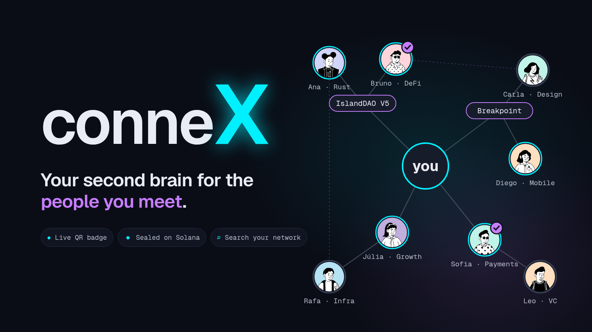
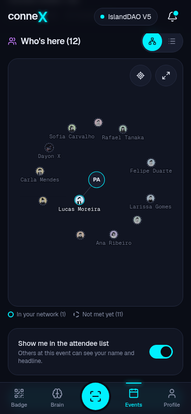
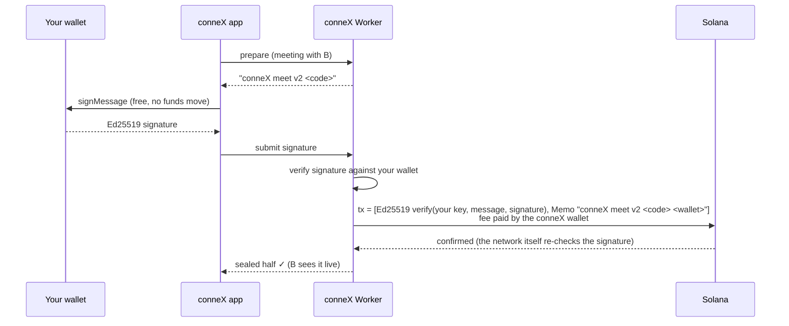
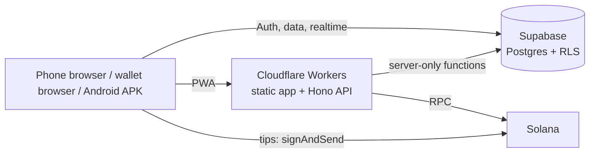

<p align="center">
  
</p>

<h1 align="center">conneX</h1>

<p align="center">
  <b>Your social brain.</b> Remember everyone you meet in real life, prove you actually met, and find them again.
  <br />
  <a href="https://connex.contact"><b>connex.contact</b></a> · Built for the Solana Seeker and the IslandDAO V5 hacker house
</p>

---

## Why

At a hacker house or a conference you meet fifty people in three days. A week later you remember a face, a project and maybe a first name. Contact apps save a card, event apps keep the data inside the event, and attendance badges prove you were there, but not who you talked to.

conneX is the missing memory layer: every connection is made by scanning a **live QR badge** in person, saved with **where, when and why** you met, and kept in a personal network you can **search in plain words** or explore as a **graph**. On Solana, two people can **seal** a meeting together, an organizer can **prove attendance**, and anyone can **tip** a builder they liked, all with the wallet they already have.

## Features

| | |
|---|---|
| **Live QR badge** | The QR changes every 30 seconds (signed token), so a screenshot can't fake a meeting. You choose which links and wallet go out by default, and can change it per person. |
| **Brain** | Every connection with event, time, private notes and tags. Search like you think (*"Rust devs I met at IslandDAO"*) or see your network as a force graph with names that never overlap. |
| **Events** | Create or join with a 6-character code. See who's here, who matches what you offer or look for, and an **event graph**: people you already know and people you haven't met yet. Organizers edit the event and show a rotating presence QR at the door. |
| **Seal on Solana** | Both people sign the same meeting code in their own wallets; conneX publishes it on-chain and pays the fee. Each side sees the other sign live, or later from a notification. |
| **Proof of presence** | Scanning the organizer's presence QR records on Solana that your wallet was at the event. |
| **Tips in SOL** | Send SOL straight from wallet to wallet. conneX never holds funds; it only verifies the transfer on-chain to notify the receiver. |
| **Notifications** | Who connected with you, who signed a seal, who tipped you. |
| **Sign in with Solana** | No email, no password. The wallet signature is the login (Phantom, Solflare, Seed Vault through Mobile Wallet Adapter). |

<p align="center">
  
</p>

## How the on-chain proofs work

The user never signs a transaction, only a short text message. That keeps wallets from rewriting the transaction (adding priority fees or security instructions that the sponsor would pay for) and means the server only ever signs transactions it built itself.



- **Nothing personal goes on-chain.** A seal only shows that two wallets signed the same random code. Names, notes and the event stay off-chain.
- **The sponsor can't be drained.** The only signer and the only writable account is the fee payer; the transaction is built server-side from a fixed template and simulated before it is sent.
- **Tips are verified.** A tip notification is stored only after the Worker finds the confirmed transfer on-chain, sent from the sender's own profile wallet to the receiver's.

## Architecture



| Layer | Stack |
|---|---|
| App | React 19, Vite, Tailwind CSS v4, PWA (Workbox), d3-force graph |
| Wallets | `@solana/wallet-adapter-react`, `@solana-mobile/wallet-standard-mobile` (MWA) |
| API | Cloudflare Workers + Hono (`worker/`), `@solana/web3.js` |
| Data | Supabase: Postgres with row-level security on every table, Auth (Sign in with Solana), Realtime, Storage |
| Android | Solana Mobile `webshell` (WebView shell for the Solana dApp Store), patched for camera, uploads and App Links |

## Security

- **Row-level security everywhere.** Clients never write tables directly for anything sensitive; they call database functions that validate every rule (verified connection on both sides, rotating QR tokens, organizer-only actions). `supabase/tests/rls_test.sql` runs 60+ checks inside a transaction that rolls back.
- **Server-only steps** (confirming proofs, recording tips) require a secret held by the Worker; the database stores only its SHA-256.
- **Strict signature checks** before anything is broadcast, plus a preflight simulation.
- **Hardened web app:** strict Content-Security-Policy and security headers (`public/_headers`), pinned dependencies with a lockfile.
- Found something? See [SECURITY.md](SECURITY.md).

## Project structure

```
src/
  pages/        screens (Badge, Brain, Events, Profile, Scan, public profile…)
  components/   UI, graph (BrainGraph), seal and presence sheets, notifications
  lib/          Supabase client, proofs, search, matching, avatars, hooks
  i18n/         all user-facing copy (English)
worker/         Cloudflare Worker API: /api/proofs/*, /api/tips/record
supabase/
  migrations/   schema, RLS policies and database functions
  tests/        security tests (RLS, privileges, RPCs)
scripts/        proof tests (unit + devnet end-to-end), seeding, APK patch
public/         PWA assets, security headers, press kit
```

## Run it locally

Requirements: Node 22+, a Supabase project, a Cloudflare account.

```bash
npm install
cp .env.example .env          # VITE_SUPABASE_URL, VITE_SUPABASE_PUBLISHABLE_KEY, …
npm run dev                   # app + Worker on http://localhost:5173
```

In development the sign-in sheet offers a **dev wallet** (a local keypair), so you can test without a wallet extension.

| Command | What it does |
|---|---|
| `npm run build` | Typecheck and production build |
| `npm run deploy:dev` | Test version on devnet |
| `npm run deploy` | Production (mainnet) |
| `node --test scripts/proof-tx.test.mjs` | Unit tests of the proof format and signature checks |
| `node scripts/proof-e2e.mjs <state.json>` | End-to-end proofs against the devnet deployment |
| `psql "$SUPABASE_DB_URL" -f supabase/tests/rls_test.sql` | Database security tests |

Worker secrets (`wrangler secret put`): `FEE_PAYER_SECRET` (the wallet that pays proof fees), `PROOF_SERVER_SECRET`, `SOLANA_RPC_URL`.

## Roadmap

- Seals as standard on-chain attestations other apps can read
- Shareable "tip me / connect with me" links that unfold inside X (Solana Actions)
- Organizer dashboard: connections made, seals and presence per event
- iOS live camera inside wallet browsers (today: scan from a photo)

## Background

conneX started at the IslandDAO V5 hacker house (Florianópolis, November 2026). The original product and technical plan (in Portuguese) is in [docs/PLANO.md](docs/PLANO.md).

Contact: [hello@connex.contact](mailto:hello@connex.contact)
